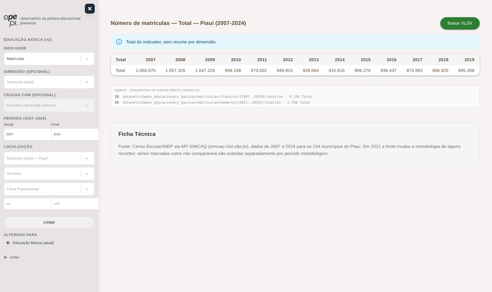
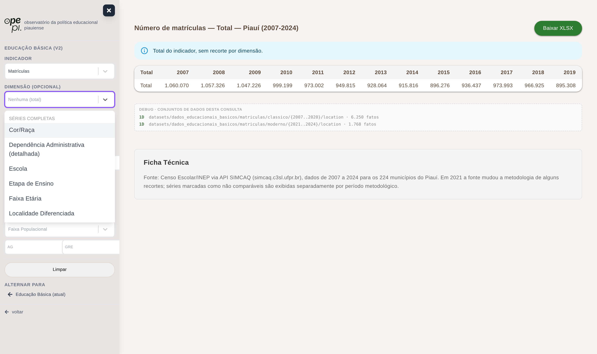
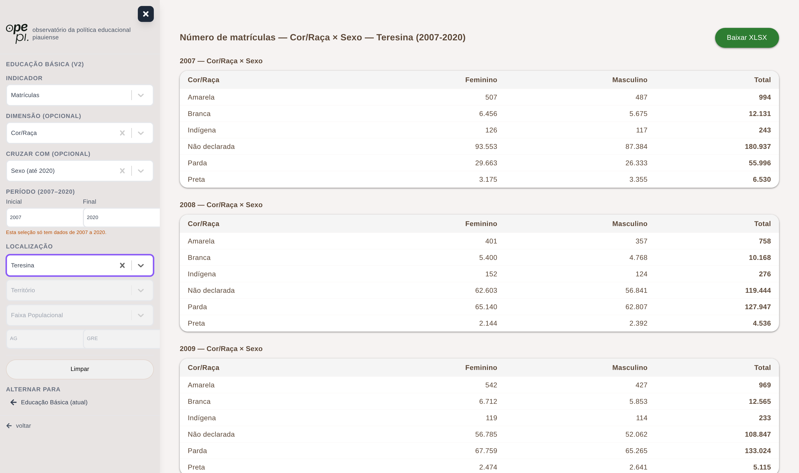

# Dados educacionais SIMCAQ — schema `educacao_v2`

Esta é a base de dados do **Censo Escolar** (INEP) para os **224 municípios do
Piauí + o estado**, cobrindo **2007–2024**, com **14.878.261 fatos** importados
dos datasets locais em `observatorio-ufpi/datasets/`.

Ela vive no banco de educação já existente (`educacao-database`, container
`observatorio_educacao_container`, porta 5438), mas em um **schema Postgres
próprio**, isolado do `public` usado pela API atual ("v1"). Isso significa que
dá para testar, evoluir e até descartar tudo (`DROP SCHEMA educacao_v2
CASCADE;`) sem encostar em nada que está em produção.

Arquivos de referência:

- Schema Prisma: [schema.prisma](./schema.prisma) (client gerado em `generated/educacao-v2-client`)
- Importador principal: [scripts/import-datasets.mjs](../../scripts/import-datasets.mjs)
- Normalização clássico/moderno: [scripts/backfill-canonico.sql](../../scripts/backfill-canonico.sql)
- Recuperação dos cruzamentos de PEE: [scripts/import-pee-blocos.mjs](../../scripts/import-pee-blocos.mjs)
- Auditoria banco × disco: [scripts/audit-import.mjs](../../scripts/audit-import.mjs)
- Comparador v1 × v2 × fonte: [scripts/compare-v1-v2.mjs](../../scripts/compare-v1-v2.mjs)
- Módulo NestJS que consome este schema: `api/src/education/v2/`

O schema tem **apenas 4 tabelas** — sem views e sem tabelas auxiliares. Toda
consulta é na `FatoEducacao` com joins em `ValorDimensao`/`Localidade` (ou
`include` no Prisma):

| Tabela | Linhas | Papel |
|---|---|---|
| `FatoEducacao` | 14,9 mi | Um número por linha: `(referencia, ano, localidade, valor_dim1, valor_dim2) -> total` |
| `Dimensao` | 36 | Catálogo de dimensões (`gender`, `location`, `school`...) + `nome_canonico` |
| `ValorDimensao` | 8.906 | Valores de cada dimensão (`Feminino`, `Urbana`, cada escola...) + `valor_canonico_id` |
| `Localidade` | 225 | Municípios do PI + o estado; `id` e `codigo_ibge` = código IBGE |

## 1. Vocabulário básico

Se você nunca mexeu neste projeto, estes são os seis termos que aparecem o
tempo todo:

| Termo | O que é | Exemplo |
|---|---|---|
| **Indicador** | *O quê* está sendo contado. São 6: `matriculas`, `docentes`, `turmas`, `escolas`, `funcionarios`, `auxiliares` | "número de matrículas" |
| **Dimensão** | Um eixo de recorte dos dados | `gender` (sexo), `location` (urbana/rural), `school` (escola) |
| **Valor de dimensão** | Uma categoria dentro de uma dimensão | `Feminino`, `Urbana`, a escola "Paes Landim" |
| **Recorte (slug `dims`)** | A combinação de dimensões de uma consulta: **1D** (uma dimensão) ou **2D** (cruzamento de duas) | `gender` (1D); `ethnic_group_gender` (2D: etnia × sexo) |
| **Fato** | Uma linha da `FatoEducacao`: um número para um indicador + ano + localidade + recorte | "matrículas, Teresina, 2015, Branca × Feminino = 8.198" |
| **Clássico / moderno** | As duas "eras" da fonte de dados: até 2020 (clássico) e de 2021 em diante (moderno), que usam nomes diferentes para algumas dimensões | `gender` (clássico) vs `gender_entity` (moderno) |

A hierarquia mental para qualquer consulta é sempre:
**indicador** (o quê) → **dims_canonico** (recorte) → **ano + localidade**
(quando/onde) → **valores** → **total**.

E "**canônico**", a palavra mais importante do modelo, está explicada na
[seção 5](#5-a-camada-canônica--o-problema-clássico--moderno).

## 2. De onde vêm os dados

Os datasets são *dumps* da API SIMCAQ/LDE (`simcaq.c3sl.ufpr.br/api/v1/`), uma
plataforma da UFPR que publica agregações do Censo Escolar do INEP. São **um
arquivo JSON por município**, organizados em pastas por categoria → ano →
dimensão:

```text
datasets/
├── dados_educacionais_basicos/                  "1D": totais por UMA dimensão
│   ├── escolas/2024/location/2211001_TERESINA.json
│   ├── matriculas/classico/2015/ethnic_group/...      (clássico: 2007–2020)
│   ├── matriculas/moderno/2021/gender/...             (moderno: 2021+)
│   ├── docentes/{classico,moderno}/...
│   └── turmas/ funcionarios/ auxiliares/ ...
└── dados_educacionais_basicos_microdados (2)/dados_educacionais_basicos_microdados/
    └── ...                                      "2D": cruzamentos de DUAS dimensões
        └── matriculas/classico/2015/ethnic_group_X_gender/2211001_TERESINA.json
```

Exemplo real — `docentes/classico/2020/gender/2211001_TERESINA.json`
(docentes de Teresina em 2020, recorte por sexo):

```json
{
  "meta": {
    "endpoint": "teacher",
    "dims": "gender",
    "url": "https://simcaq.c3sl.ufpr.br/api/v1/teacher?dims=gender&filter=...city:\"2211001\"..."
  },
  "result": [
    { "total": 2907, "year": 2020, "gender_id": 1, "gender_name": "Masculino" },
    { "total": 6071, "year": 2020, "gender_id": 2, "gender_name": "Feminino" }
  ]
}
```

Cada item de `result` vira **uma linha** de `FatoEducacao`. O parser do
importador é genérico: ele lê os pares `<dim>_id` / `<dim>_name` de cada item,
sem precisar de mapeamento por categoria — foi assim que as 36 dimensões e os
259 recortes entraram com um importador só.

## 3. Por que um modelo dimensional genérico (e não o schema `public`)

O schema `public` atual (tabela `DadoEducacaoBasica`) tem **uma coluna FK por
dimensão**. Funciona para os poucos recortes que ele cobre (dependência
administrativa × localização × etapa), mas não comporta este dataset: são 36
dimensões e 259 combinações (`sexo × etnia`, `faixa etária × escola`, `tipo de
contrato × escolaridade do docente`...). Adicionar 30+ colunas FK e uma
migração para cada dimensão nova não escala.

Aqui o modelo é **dimensional genérico**: a dimensão é **linha** de `Dimensao`,
não coluna da tabela de fatos. As duas tabelas de dimensão têm papéis
distintos:

- `Dimensao` é o **catálogo**: "existe um recorte chamado `gender`";
- `ValorDimensao` são os **valores possíveis** desse recorte: "`gender` tem
  `Masculino` (codigo_api 1) e `Feminino` (codigo_api 2)".

Cada fato aponta para até dois `ValorDimensao` (`valor_dim1`, `valor_dim2`) e
carrega o slug `dims` dizendo qual combinação ele representa.

## 4. Como um JSON vira linhas (rastreabilidade de ponta a ponta)

O arquivo 2D real
`matriculas/classico/2015/ethnic_group_X_gender/2211001_TERESINA.json` contém
itens como `{ethnic_group_id: 1 "Branca", gender_id: 2 "Feminino", total: 8198}`.
No banco isso vira:

| referencia | dims | ano | localidade_id | valor_1 | valor_2 | total |
|---|---|---|---|---|---|---|
| `matriculas/classico` | `ethnic_group_gender` | 2015 | 2211001 | Amarela | Feminino | 557 |
| `matriculas/classico` | `ethnic_group_gender` | 2015 | 2211001 | Amarela | Masculino | 522 |
| `matriculas/classico` | `ethnic_group_gender` | 2015 | 2211001 | Branca | Feminino | 8198 |
| `matriculas/classico` | `ethnic_group_gender` | 2015 | 2211001 | Branca | Masculino | 7681 |

E o caminho de volta ao arquivo de origem é determinístico:

```text
<raiz>/<referencia>/<ano>/<pasta da dimensão>/<codigo_ibge>_<NOME_MUNICIPIO>.json
raiz 1D: datasets/dados_educacionais_basicos  (dims com 1 dimensão)
raiz 2D: datasets/dados_educacionais_basicos_microdados (2)/... (dims com 2 dimensões)
```

### A coluna `referencia`

É o diretório do dataset de onde o fato foi importado, no nível
categoria[/era]. Serve para **proveniência** (saber de onde o dado veio), não
para consulta — para consultar, use `indicador` + `dims_canonico` (seção 5).
Os 8 valores existentes:

| referencia | fatos |
|---|---|
| `matriculas/classico` | 5.414.142 |
| `docentes/classico` | 3.650.853 |
| `turmas` | 2.959.502 |
| `matriculas/moderno` | 986.597 |
| `funcionarios` | 823.561 |
| `escolas` | 636.657 |
| `auxiliares` | 360.357 |
| `docentes/moderno` | 46.592 |

## 5. A camada canônica — o problema clássico × moderno

### O que significa "canônico"

**Canônico = a forma de referência.** A fonte de dados às vezes dá nomes
diferentes para a mesma coisa (a dimensão de sexo chama `gender` até 2020 e
`gender_entity` de 2021 em diante). Em vez de apagar ou renomear o que chegou
— o que destruiria a rastreabilidade —, o modelo **mantém os dois como
chegaram e elege um deles como o canônico**; o outro ganha um ponteiro para a
sua versão canônica.

Na prática: **quem consulta usa só os campos canônicos** e enxerga uma série
única e contínua de 2007 a 2024; **quem audita** ainda consegue ver o nome
original e chegar ao arquivo exato de onde cada número veio.

### O problema que isso resolve

Em 2021 a API SIMCAQ trocou os endpoints de matrículas e docentes e **renomeou
dimensões**. No dataset isso aparece como os subdiretórios `classico`
(2007–2020) e `moderno` (2021+). Os dados significam a mesma coisa — as séries
emendam sem degrau — mas chegam com nomes diferentes. Exemplo real, docentes
de Teresina por sexo:

```text
clássico 2020 (docentes/classico/2020/gender):        moderno 2021 (docentes/moderno/2021/gender_entity):
  dims: "gender"                                        dims: "gender_entity"
  { gender_id: 2, gender_name: "Feminino",              { gender_entity_id: 2, gender_entity_name: "Feminino",
    total: 6071 }                                         total: 5780 }
```

Sem tratamento, uma consulta "docentes mulheres por ano" teria que saber que
até 2020 o recorte chama `gender` e depois chama `gender_entity`.

### As colunas canônicas

A normalização materializa a unificação em colunas calculadas, preenchidas
pelo `backfill-canonico.sql` (que roda após **cada** importação):

1. **`FatoEducacao.indicador`** — o "o quê" lógico, sem era:
   `split_part(referencia, '/', 1)` → `matriculas/classico` e
   `matriculas/moderno` viram ambos `matriculas`.
2. **`Dimensao.nome_canonico`** — o nome de referência da dimensão
   (`gender_entity` → `gender`). Quando é NULL, a dimensão já é a canônica
   (use `COALESCE(nome_canonico, nome)`).
3. **`ValorDimensao.valor_canonico_id`** — ponteiro do valor "não canônico"
   para o seu equivalente, casado pelo nome dentro da dimensão canônica. Para
   valores que já são os canônicos, é NULL. No banco de verdade:

| dimensão | codigo_api | valor | valor_canonico_id |
|---|---|---|---|
| `gender` | 1 | Masculino | — (é o próprio canônico) |
| `gender` | 2 | Feminino | — |
| `gender_entity` | 1 | Masculino | 24 (→ `gender` Masculino) |
| `gender_entity` | 2 | Feminino | 23 (→ `gender` Feminino) |

4. **`FatoEducacao.dims_canonico`** — o slug `dims` reescrito com os nomes
   canônicos (`gender_entity` → `gender`), sempre em ordem alfabética.

Resultado: uma única consulta atravessa a troca de era:

```text
indicador='docentes', dims_canonico='gender', valor canônico='Feminino', Teresina:
 2019 | docentes/classico | 6693      ┐ sem degrau na emenda
 2020 | docentes/classico | 6071      │ (mesma coisa p/ matrículas:
 2021 | docentes/moderno  | 5780      │  103.854 → 98.414 → 98.854 → 99.738)
 2022 | docentes/moderno  | 5952      ┘
```

Dimensões unificadas (37 valores casados, 153 slugs mapeados):

| Dimensão canônica | Nomes originais unificados |
|---|---|
| `gender` | `gender`, `gender_entity` |
| `location` | `location`, `location_entity` |
| `contract_type` | `contract_type`, `contract_type_entity` |
| `education_level_mod` | `education_level_mod`, `education_level_mod_agg` |
| `integral_time` | `integral_time`, `integral_time_agg` |
| `period` | `period`, `period_agg` |

## 6. O que NÃO foi unificado — de propósito

Unificar dimensões com **agregações incompatíveis** produziria séries
mentirosas. Nesses casos `dims_canonico = dims` e a série completa exige olhar
os dois recortes (o clássico até 2020 e o moderno de 2021 em diante). Os
casos, com os valores reais do banco:

- **Dependência administrativa**: `adm_dependency_detailed` tem 8 categorias
  (Federal, Estadual, Municipal + 5 recortes de privada: conveniada/não
  conveniada × com/sem fins lucrativos...), enquanto `adm_dependency_entity`
  só tem Federal/Estadual/Municipal/Privada. Não há como mapear "Privada" de
  volta para as 5 subcategorias.
- **Faixa etária** — três famílias com cortes diferentes:
  - `age_range_all` (clássico): 0–3, 4–5, 6–10, 11–14, 15–17, 18–24, 25–29,
    30–40, 41–50, 51–64, 64+;
  - `age_range_aggregate` (moderno, matrículas): 0–3, 4–5, 6–10, 11–14, 15–17,
    18+ — o "18 ou mais" funde seis faixas do clássico;
  - `age_range_entity` (moderno, docentes): até 24, 25–29, 30–39, 40–49,
    50–54, 55–59, 60+ — cortes que nem se alinham com os anteriores.
- **Escolaridade do docente**: `education_type` (clássico, 12 valores tipo
  "Mestrado com licenciatura") × `education_degree_entity` (moderno, valores
  tipo "Graduação Com Licenciatura") — granularidades diferentes.
- **Etapas modernas** `education_level_mod_entity_agg`/`_seg`: recortes novos
  de etapa que não batem 1:1 com `education_level_mod`.

A lista completa de recortes disponíveis por indicador está no
[Apêndice A](#apêndice-a--recortes-disponíveis-indicador--dims_canonico); os
valores de cada dimensão, no
[Apêndice B](#apêndice-b--dimensões-canônicas-e-valores).

## 7. Convenções do modelo

- **1D**: `valor_dim2_id = 0` — registro sentinela "TOTAL" (o Postgres 13 não
  tem `NULLS NOT DISTINCT`, então NULL quebraria a constraint unique).
- **Slug `dims` normalizado**: dimensões em ordem alfabética unidas por `_` —
  nunca existe `location_gender`, só `gender_location`. Bom para filtro exato.
- **`codigo_api`** é o id que a própria API de origem usa; para `school` é o
  **código INEP** da escola. Valores que a API devolve **sem id** ganham
  código sintético negativo (hash determinístico do nome) — casos reais:
  `contract_type` -1 "Não classificado" e as categorias de `pee_por_categoria`
  ("Autismo" -9, "Baixa visão" -2...).
- **Idempotência**: unique `(referencia, ano, localidade_id, valor_dim1_id,
  valor_dim2_id)` + `createMany skipDuplicates` — reimportar não duplica nada.
- **Localidade**: `id` = código IBGE numérico (`2211001` Teresina, `22` o
  estado), `codigo_ibge` string para joins com outras bases.
- Índices prontos para a API: `(indicador, ano, localidade_id)`,
  `(indicador, dims_canonico, ano)` e os equivalentes por `referencia`.
- **O que fica de fora da importação, e por quê** (~1,04 mi de linhas do
  dataset, todas auditadas):
  - ~406 mil linhas de funcionários por função com `total: "N/A"` — a fonte
    não tem o número; não há o que importar;
  - ~312 mil linhas "degeneradas" de `matriculas/moderno` e `docentes/moderno`
    — um bug de serialização da fonte devolve ids sintéticos sem nome e sem
    qualquer rótulo no arquivo; importar exigiria adivinhar a enumeração;
  - ~322 mil pseudo-linhas de rodapé dos arquivos de PEE por categoria — não
    são dados; são os rótulos que o parser de recuperação (item 7 do
    histórico) consome para decodificar os blocos.

## 8. Receitas de consulta

Lembrando a hierarquia: **indicador** (o quê) → **dims_canonico** (recorte) →
**ano + localidade** (quando/onde) → **valores** → **total**.

### SQL

```sql
-- Série histórica 2007-2024: docentes mulheres em Teresina
-- (atravessa clássico/moderno sozinha)
SELECT f.ano, f.total, f.referencia
FROM educacao_v2."FatoEducacao" f
JOIN educacao_v2."ValorDimensao" v1 ON v1.id = f.valor_dim1_id
LEFT JOIN educacao_v2."ValorDimensao" cv1 ON cv1.id = v1.valor_canonico_id
JOIN educacao_v2."Localidade" l ON l.id = f.localidade_id
WHERE f.indicador = 'docentes' AND f.dims_canonico = 'gender'
  AND COALESCE(cv1.nome, v1.nome) = 'Feminino' AND l.codigo_ibge = '2211001'
ORDER BY f.ano;

-- Cruzamento 2D: matrículas por etnia x sexo, Teresina 2015
SELECT v1.nome AS etnia, COALESCE(cv2.nome, v2.nome) AS sexo, f.total
FROM educacao_v2."FatoEducacao" f
JOIN educacao_v2."ValorDimensao" v1 ON v1.id = f.valor_dim1_id
JOIN educacao_v2."ValorDimensao" v2 ON v2.id = f.valor_dim2_id
LEFT JOIN educacao_v2."ValorDimensao" cv2 ON cv2.id = v2.valor_canonico_id
WHERE f.indicador = 'matriculas' AND f.dims_canonico = 'ethnic_group_gender'
  AND f.ano = 2015 AND f.localidade_id = 2211001;

-- Por escola (codigo_api = código INEP): matrículas 2024 em Paes Landim
SELECT v1.nome AS escola, v1.codigo_api AS inep, f.total
FROM educacao_v2."FatoEducacao" f
JOIN educacao_v2."ValorDimensao" v1 ON v1.id = f.valor_dim1_id
WHERE f.indicador = 'matriculas' AND f.dims_canonico = 'school'
  AND f.ano = 2024 AND f.localidade_id = 2207306
ORDER BY f.total DESC;

-- Descobrir recortes disponíveis de um indicador
SELECT dims_canonico, MIN(ano) AS de, MAX(ano) AS ate, COUNT(*) AS fatos
FROM educacao_v2."FatoEducacao"
WHERE indicador = 'escolas'
GROUP BY dims_canonico ORDER BY dims_canonico;
```

O padrão `COALESCE(cv.nome, v.nome)` aparece sempre: é "use o nome canônico se
existir; senão, o valor já é o canônico".

### Prisma (service NestJS)

```ts
import { PrismaClient } from 'prisma/educacao-v2/generated/educacao-v2-client';

const fatos = await prisma.fatoEducacao.findMany({
  where: {
    indicador: 'matriculas',
    dims_canonico: 'ethnic_group_gender',
    ano: 2015,
    localidade: { codigo_ibge: '2211001' },
  },
  include: {
    valor_dim1: { include: { valor_canonico: true, dimensao: true } },
    valor_dim2: { include: { valor_canonico: true, dimensao: true } },
    localidade: true,
  },
});
// nome unificado do valor: fato.valor_dim1.valor_canonico?.nome ?? fato.valor_dim1.nome
```

Para agregações pesadas, `prisma.$queryRaw` com os SQLs acima funciona bem.
Exemplos reais de consumo estão no módulo `api/src/education/v2/`
(`educacao-v2.service.ts` e `catalogo.config.ts`).

## 9. O front de validação (rota `/dados-educacionais/basica-v2`)

No projeto web (branch `educacao-v2`) existe uma página paralela à de educação
básica atual que consome os endpoints `/v2/educacao/*` — ela serve tanto de
protótipo da integração quanto de ferramenta de validação dos dados. Os prints
abaixo mostram como os conceitos deste documento aparecem na interface.

### Filtros

A consulta é dirigida pelo catálogo (`/v2/educacao/catalogo`), na mesma
hierarquia do modelo: **indicador** → **dimensão (opcional)** → **cruzar com
(opcional, forma o recorte 2D)** → **período** → **localização**. Sem dimensão
selecionada, a página mostra o **Total** do indicador:



Repare no rodapé da tabela: mesmo o "Total" declara de onde veio — das pastas
`location` do clássico (2007–2020) e do moderno (2021–2024), somando Urbana +
Rural (seção 5 explica por quê).

O filtro de dimensão agrupa as opções pela **disponibilidade na linha do
tempo**, deixando explícito o mapeamento das seções 5 e 6:

- **Séries completas** — cobrem toda a linha do tempo do indicador;
- **Disponível em parte do período** — séries parciais, com o alcance no
  próprio rótulo (ex.: "Sexo (até 2020)");
- **Metodologia mudou em 2021** — as séries quebradas da seção 6, exibidas
  separadas por era.



O filtro "Cruzar com" só oferece as combinações 2D que existem de fato no
catálogo para a dimensão escolhida, e o filtro de período se ajusta ao alcance
do recorte — com aviso quando a seleção não cobre a linha do tempo inteira:



### Painel de debug (proveniência da consulta)

Abaixo de cada resultado, um painel discreto lista **de quais diretórios do
dataset vieram os fatos daquela consulta** — direto do `meta.fontes` que a API
retorna em toda resposta de `/v2/educacao/fatos`. Cada linha traz o tipo (1D
ou 2D), o caminho da pasta com o intervalo de anos no lugar do `{ano}`, e
quantos fatos vieram dela:


É a materialização da rastreabilidade da seção 4: basta abrir o diretório
indicado e conferir o JSON do município para validar qualquer número da tela.
Em séries que atravessam a troca de era aparecem duas linhas (ex.:
`docentes/classico/{ano}/gender` e `docentes/moderno/{ano}/gender_entity`) —
útil para verificar a emenda clássico/moderno descrita na seção 5.

## 10. Operação

```bash
# importar (retomável; idempotente). Depois de importar, SEMPRE rodar o backfill:
node scripts/import-datasets.mjs --workers=10
docker exec -i observatorio_educacao_container sh -c \
  'psql -U "$POSTGRES_USER" -d "$POSTGRES_DB" -v ON_ERROR_STOP=1' \
  < scripts/backfill-canonico.sql

# recuperar os cruzamentos de PEE por categoria (formato de blocos; ver item 7 do histórico)
node scripts/import-pee-blocos.mjs

# auditar banco x disco (usa os critérios do importador original; os grupos de
# PEE recuperados aparecem como "só no banco" — é esperado)
node scripts/audit-import.mjs

# comparar v1 x v2 x dataset (e, com --simcaq, a fonte externa ao vivo)
node scripts/compare-v1-v2.mjs [--simcaq]

# migrations deste schema
npx prisma migrate deploy --schema=./prisma/educacao-v2/schema.prisma
npx prisma generate --schema=./prisma/educacao-v2/schema.prisma

# descartar tudo (não toca no schema public)
# DROP SCHEMA educacao_v2 CASCADE;
```

Conexão direta (DBeaver): host `localhost`, porta `5438`, banco
`educacao-database`, usuário `root`, schema `educacao_v2` (senha =
`POSTGRES_EDUCACAO_PASSWORD` no `.env` da raiz). JDBC:
`jdbc:postgresql://localhost:5438/educacao-database?currentSchema=educacao_v2`.

## 11. Histórico de decisões (o que foi feito e por quê)

1. **Schema Postgres novo (`educacao_v2`), não o `public`.** O dataset e o
   banco atual vêm da mesma fonte (API SIMCAQ) — validamos igualdade no nível
   de valor —, mas o `public` só cobre uma fração dos recortes (dependência
   administrativa × localização × etapa) e seu modelo de uma-FK-por-dimensão
   não comporta as 36 dimensões do dataset. O schema isolado permite testar
   sem nenhum risco ao que a API usa hoje.

2. **Importador genérico e paralelo** (`scripts/import-datasets.mjs`): 10
   workers (`worker_threads`), cada um com seu PrismaClient, processando
   pastas de dimensão em paralelo — importação completa dos ~837 mil arquivos
   em ~5–6 min. Progresso em `scripts/progresso-import-datasets.json`
   (retomável após interrupção) e inserção via `createMany skipDuplicates`
   (reimportar nunca duplica). Duas execuções completas produziram exatamente
   os mesmos 12.626.291 fatos.

3. **Município = código IBGE, dimensões = slug com `_`.** `Localidade.id` é o
   próprio código IBGE do JSON (`2211001`); o slug `dims` em ordem alfabética
   dá filtro exato e barato por recorte.

4. **Camada canônica para clássico × moderno** (seções 5 e 6): depois de
   confirmar que as séries emendam sem degrau, unificamos por nome as
   dimensões renomeadas e materializamos `indicador` + `dims_canonico` no fato
   — uma consulta cobre 2007–2024. Onde as agregações eram incompatíveis,
   mantivemos separado de propósito.

5. **`referencia` em vez de endpoint.** O fato guardava o endpoint da API de
   origem (`teacher`, `enrollmentAggregate`...); trocamos pelo diretório do
   dataset (`docentes/classico`...), que é mais legível e aponta direto para a
   pasta de onde o dado veio. O endpoint continua no `meta` de cada JSON.

6. **Simplificação final: 4 tabelas, sem view.** A tabela `DiretorioDataset`
   (4.136 pastas) e a view `FatoEducacaoCanonico` foram removidas: a
   `referencia` + `ano` + `dims` já reconstituem o caminho da pasta, e com
   `indicador`/`dims_canonico` materializados no fato os joins diretos ficaram
   triviais (receitas na seção 8).

7. **Recuperação dos cruzamentos de PEE por categoria**
   (`scripts/import-pee-blocos.mjs`). Os 12 cruzamentos 2D de
   `matriculas/classico` com `pee_por_categoria` (PEE = público da educação
   especial) vinham com um bug de serialização da fonte: blocos de linhas sem
   nome seguidos de um "rodapé" com os rótulos. Um parser dedicado decodifica
   os blocos e **reprova o grupo inteiro diante de qualquer anomalia**; cada
   grupo foi validado contra a série 1D já importada (12/12 grupos aprovados,
   25.268 arquivos, 379.638 somas por categoria conferidas, todas exatas).
   Resultado: **+2.251.970 fatos**, levando o banco de 12.626.291 para
   14.878.261 e `matriculas` de 94 para 106 recortes. O que continua fora está
   listado na seção 7 — em resumo, só ficou de fora o que não tem valor
   (`"N/A"`) ou não tem rótulo decodificável com certeza (moderno degenerado).

Validações feitas: contagem estável entre reimportações; emenda
clássico/moderno conferida em Teresina (docentes por sexo e matrículas
totais); amostras 1D e 2D conferidas contra os JSONs de origem; linhas não
importadas auditadas uma a uma (seção 7); comparação em quatro camadas
(v1 × v2 × dataset × API SIMCAQ ao vivo, 240 casos) com a v2 batendo 100% com
o dataset e com a fonte externa em todos os casos comparáveis.

## Apêndice A — Recortes disponíveis (indicador × dims_canonico)

São 259 recortes no total: auxiliares 36, docentes 53, escolas 21,
funcionários 15, matrículas 106, turmas 28. Nos recortes de matrículas, `†`
marca os 12 cruzamentos de PEE recuperados pelo parser de blocos (item 7 do
histórico).

### auxiliares
| dims_canonico | anos | fatos |
|---|---|---|
| `adm_dependency_detailed` | 2007–2020 | 2.908 |
| `adm_dependency_detailed_diff_location` | 2007–2020 | 3.156 |
| `adm_dependency_detailed_education_level_mod` | 2007–2020 | 8.076 |
| `adm_dependency_detailed_education_type` | 2007–2020 | 8.358 |
| `adm_dependency_detailed_ethnic_group` | 2007–2020 | 7.446 |
| `adm_dependency_detailed_gender` | 2007–2020 | 4.002 |
| `adm_dependency_detailed_location` | 2007–2020 | 4.502 |
| `adm_dependency_detailed_school` | 2007–2020 | 24.961 |
| `diff_location` | 2007–2020 | 2.261 |
| `diff_location_education_level_mod` | 2007–2020 | 5.685 |
| `diff_location_education_type` | 2007–2020 | 5.815 |
| `diff_location_ethnic_group` | 2007–2020 | 5.263 |
| `diff_location_gender` | 2007–2020 | 2.992 |
| `diff_location_location` | 2007–2020 | 3.428 |
| `diff_location_school` | 2007–2020 | 11.981 |
| `education_level_mod` | 2007–2020 | 5.099 |
| `education_level_mod_education_type` | 2007–2020 | 9.847 |
| `education_level_mod_ethnic_group` | 2007–2020 | 8.440 |
| `education_level_mod_gender` | 2007–2020 | 4.517 |
| `education_level_mod_location` | 2007–2020 | 8.404 |
| `education_level_mod_school` | 2007–2020 | 43.926 |
| `education_type` | 2007–2020 | 5.246 |
| `education_type_ethnic_group` | 2007–2020 | 8.761 |
| `education_type_gender` | 2007–2020 | 4.615 |
| `education_type_location` | 2007–2020 | 8.519 |
| `education_type_school` | 2007–2020 | 43.934 |
| `ethnic_group` | 2007–2020 | 4.782 |
| `ethnic_group_gender` | 2007–2020 | 4.066 |
| `ethnic_group_location` | 2007–2020 | 7.669 |
| `ethnic_group_school` | 2007–2020 | 35.629 |
| `gender` | 2007–2020 | 2.749 |
| `gender_location` | 2007–2020 | 4.248 |
| `gender_school` | 2007–2020 | 16.932 |
| `location` | 2007–2020 | 3.137 |
| `location_school` | 2007–2020 | 18.660 |
| `school` | 2007–2020 | 10.343 |

### docentes
| dims_canonico | anos | fatos |
|---|---|---|
| `adm_dependency_detailed` | 2007–2020 | 8.136 |
| `adm_dependency_detailed_contract_type` | 2007–2020 | 19.292 |
| `adm_dependency_detailed_diff_location` | 2007–2020 | 11.379 |
| `adm_dependency_detailed_education_level_mod` | 2007–2020 | 69.977 |
| `adm_dependency_detailed_education_type` | 2007–2020 | 48.881 |
| `adm_dependency_detailed_ethnic_group` | 2007–2020 | 37.369 |
| `adm_dependency_detailed_gender` | 2007–2020 | 16.272 |
| `adm_dependency_detailed_location` | 2007–2020 | 16.236 |
| `adm_dependency_detailed_school` | 2007–2020 | 284.878 |
| `adm_dependency_entity` | 2021–2024 | 3.584 |
| `adm_dependency_entity_agg` | 2021–2024 | 1.792 |
| `age_range_entity` | 2021–2024 | 6.272 |
| `contract_type` | 2007–2024 | 10.510 |
| `contract_type_diff_location` | 2007–2020 | 9.562 |
| `contract_type_education_level_mod` | 2007–2020 | 35.519 |
| `contract_type_education_type` | 2007–2020 | 23.976 |
| `contract_type_ethnic_group` | 2007–2020 | 18.577 |
| `contract_type_gender` | 2007–2020 | 8.110 |
| `contract_type_location` | 2007–2020 | 13.814 |
| `contract_type_school` | 2007–2020 | 203.675 |
| `diff_location` | 2007–2020 | 4.217 |
| `diff_location_education_level_mod` | 2007–2020 | 35.645 |
| `diff_location_education_type` | 2007–2020 | 24.429 |
| `diff_location_ethnic_group` | 2007–2020 | 19.099 |
| `diff_location_gender` | 2007–2020 | 8.434 |
| `diff_location_location` | 2007–2020 | 8.416 |
| `diff_location_school` | 2007–2020 | 125.316 |
| `education_degree_entity` | 2021–2024 | 3.584 |
| `education_level_mod` | 2007–2020 | 25.991 |
| `education_level_mod_education_type` | 2007–2020 | 88.004 |
| `education_level_mod_entity_agg` | 2021–2024 | 13.440 |
| `education_level_mod_entity_seg` | 2021–2024 | 6.272 |
| `education_level_mod_ethnic_group` | 2007–2020 | 68.753 |
| `education_level_mod_gender` | 2007–2020 | 30.438 |
| `education_level_mod_location` | 2007–2020 | 51.863 |
| `education_level_mod_school` | 2007–2020 | 747.336 |
| `education_type` | 2007–2020 | 17.555 |
| `education_type_ethnic_group` | 2007–2020 | 46.815 |
| `education_type_gender` | 2007–2020 | 20.510 |
| `education_type_location` | 2007–2020 | 35.031 |
| `education_type_school` | 2007–2020 | 572.480 |
| `ethnic_group` | 2007–2020 | 13.973 |
| `ethnic_group_gender` | 2007–2020 | 16.298 |
| `ethnic_group_location` | 2007–2020 | 27.864 |
| `ethnic_group_school` | 2007–2020 | 397.092 |
| `gender` | 2007–2024 | 8.060 |
| `gender_location` | 2007–2020 | 12.500 |
| `gender_school` | 2007–2020 | 163.108 |
| `location` | 2007–2024 | 8.042 |
| `location_school` | 2007–2020 | 163.035 |
| `post_graduation_entity` | 2021–2024 | 2.688 |
| `school` | 2007–2020 | 81.554 |
| `special_education_entity` | 2021–2024 | 1.792 |

### escolas
| dims_canonico | anos | fatos |
|---|---|---|
| `adm_dependency_detailed` | 2007–2024 | 10.472 |
| `adm_dependency_detailed_arrangement` | 2007–2024 | 130.032 |
| `adm_dependency_detailed_diff_location` | 2007–2024 | 14.694 |
| `adm_dependency_detailed_government_agreement` | 2007–2024 | 17.981 |
| `adm_dependency_detailed_integral_time` | 2007–2024 | 16.330 |
| `adm_dependency_detailed_location` | 2007–2024 | 20.860 |
| `arrangement` | 2007–2024 | 43.164 |
| `arrangement_diff_location` | 2007–2024 | 63.987 |
| `arrangement_government_agreement` | 2007–2024 | 76.916 |
| `arrangement_integral_time` | 2007–2024 | 69.655 |
| `arrangement_location` | 2007–2024 | 86.162 |
| `diff_location` | 2007–2024 | 5.442 |
| `diff_location_government_agreement` | 2007–2024 | 8.490 |
| `diff_location_integral_time` | 2007–2024 | 8.263 |
| `diff_location_location` | 2007–2024 | 10.842 |
| `government_agreement` | 2007–2024 | 6.026 |
| `government_agreement_integral_time` | 2007–2024 | 9.549 |
| `government_agreement_location` | 2007–2024 | 12.008 |
| `integral_time` | 2007–2024 | 5.944 |
| `integral_time_location` | 2007–2024 | 11.822 |
| `location` | 2007–2024 | 8.018 |

### funcionarios
| dims_canonico | anos | fatos |
|---|---|---|
| `adm_dependency_detailed` | 2007–2024 | 10.214 |
| `adm_dependency_detailed_diff_location` | 2007–2024 | 12.524 |
| `adm_dependency_detailed_function` | 2007–2024 | 30.533 |
| `adm_dependency_detailed_location` | 2007–2024 | 16.700 |
| `adm_dependency_detailed_school` | 2007–2024 | 153.987 |
| `diff_location` | 2007–2024 | 5.442 |
| `diff_location_function` | 2007–2024 | 18.207 |
| `diff_location_location` | 2007–2024 | 9.927 |
| `diff_location_school` | 2007–2024 | 111.043 |
| `function` | 2007–2024 | 15.255 |
| `function_location` | 2007–2024 | 25.914 |
| `function_school` | 2007–2024 | 184.440 |
| `location` | 2007–2024 | 8.018 |
| `location_school` | 2007–2024 | 123.355 |
| `school` | 2007–2024 | 98.002 |

### matriculas
| dims_canonico | anos | fatos |
|---|---|---|
| `adm_dependency_detailed` | 2007–2024 | 10.537 |
| `adm_dependency_detailed_age_range_aggregate` | 2021–2024 | 14.364 |
| `adm_dependency_detailed_age_range_all` | 2007–2020 | 65.505 |
| `adm_dependency_detailed_diff_location` | 2007–2024 | 12.017 |
| `adm_dependency_detailed_education_level_mod` | 2007–2024 | 57.091 |
| `adm_dependency_detailed_ethnic_group` | 2007–2024 | 54.999 |
| `adm_dependency_detailed_gender` | 2007–2024 | 21.073 |
| `adm_dependency_detailed_integral_time` | 2007–2024 | 17.129 |
| `adm_dependency_detailed_location` | 2007–2024 | 15.271 |
| `adm_dependency_detailed_modality_integral_time` | 2021–2024 | 11.970 |
| `adm_dependency_detailed_pee` | 2007–2020 | 14.265 |
| `adm_dependency_detailed_pee_por_categoria` † | 2007–2020 | 114.002 |
| `adm_dependency_detailed_period` | 2007–2024 | 34.160 |
| `adm_dependency_detailed_school` | 2007–2024 | 98.642 |
| `adm_dependency_detailed_special_class` | 2007–2020 | 8.345 |
| `adm_dependency_detailed_special_education` | 2021–2024 | 4.788 |
| `age_range_aggregate` | 2021–2024 | 5.376 |
| `age_range_aggregate_diff_location` | 2021–2024 | 7.350 |
| `age_range_aggregate_location` | 2021–2024 | 10.608 |
| `age_range_aggregate_school` | 2021–2024 | 101.820 |
| `age_range_all` | 2007–2020 | 33.101 |
| `age_range_all_diff_location` | 2007–2020 | 40.347 |
| `age_range_all_education_level_mod` | 2007–2020 | 63.323 |
| `age_range_all_ethnic_group` | 2007–2020 | 78.731 |
| `age_range_all_gender` | 2007–2020 | 37.955 |
| `age_range_all_integral_time` | 2007–2020 | 23.998 |
| `age_range_all_location` | 2007–2020 | 59.732 |
| `age_range_all_pee` | 2007–2020 | 29.925 |
| `age_range_all_pee_por_categoria` † | 2007–2020 | 270.564 |
| `age_range_all_period` | 2007–2020 | 46.290 |
| `age_range_all_school` | 2007–2020 | 408.388 |
| `age_range_all_special_class` | 2007–2020 | 20.487 |
| `diff_location` | 2007–2024 | 5.442 |
| `diff_location_education_level_mod` | 2007–2024 | 37.747 |
| `diff_location_ethnic_group` | 2007–2024 | 28.970 |
| `diff_location_gender` | 2007–2024 | 10.883 |
| `diff_location_integral_time` | 2007–2024 | 9.521 |
| `diff_location_location` | 2007–2024 | 9.440 |
| `diff_location_modality_integral_time` | 2021–2024 | 6.125 |
| `diff_location_pee` | 2007–2020 | 7.803 |
| `diff_location_pee_por_categoria` † | 2007–2020 | 59.038 |
| `diff_location_period` | 2007–2024 | 19.447 |
| `diff_location_school` | 2007–2024 | 98.642 |
| `diff_location_special_class` | 2007–2020 | 4.466 |
| `diff_location_special_education` | 2021–2024 | 2.450 |
| `education_level_mod` | 2007–2024 | 30.934 |
| `education_level_mod_ethnic_group` | 2007–2020 | 57.267 |
| `education_level_mod_gender` | 2007–2020 | 25.703 |
| `education_level_mod_integral_time` | 2007–2020 | 14.410 |
| `education_level_mod_location` | 2007–2024 | 52.637 |
| `education_level_mod_pee` | 2007–2020 | 20.473 |
| `education_level_mod_pee_por_categoria` † | 2007–2020 | 180.138 |
| `education_level_mod_period` | 2007–2020 | 24.125 |
| `education_level_mod_school` | 2007–2024 | 361.826 |
| `education_level_mod_special_class` | 2007–2020 | 13.186 |
| `ethnic_group` | 2007–2024 | 22.711 |
| `ethnic_group_gender` | 2007–2020 | 19.441 |
| `ethnic_group_integral_time` | 2007–2020 | 13.905 |
| `ethnic_group_location` | 2007–2024 | 42.834 |
| `ethnic_group_pee` | 2007–2020 | 16.071 |
| `ethnic_group_pee_por_categoria` † | 2007–2020 | 141.694 |
| `ethnic_group_period` | 2007–2020 | 31.514 |
| `ethnic_group_school` | 2007–2024 | 404.344 |
| `ethnic_group_special_class` | 2007–2020 | 10.666 |
| `gender` | 2007–2024 | 8.060 |
| `gender_integral_time` | 2007–2020 | 5.429 |
| `gender_location` | 2007–2024 | 16.035 |
| `gender_pee` | 2007–2020 | 7.022 |
| `gender_pee_por_categoria` † | 2007–2020 | 50.988 |
| `gender_period` | 2007–2020 | 12.689 |
| `gender_school` | 2007–2024 | 197.132 |
| `gender_special_class` | 2007–2020 | 3.965 |
| `integral_time` | 2007–2024 | 7.366 |
| `integral_time_location` | 2007–2024 | 13.535 |
| `integral_time_pee` | 2007–2020 | 4.883 |
| `integral_time_pee_por_categoria` † | 2007–2020 | 38.052 |
| `integral_time_period` | 2007–2020 | 6.351 |
| `integral_time_school` | 2007–2024 | 135.802 |
| `integral_time_special_class` | 2007–2020 | 2.886 |
| `location` | 2007–2024 | 8.018 |
| `location_modality_integral_time` | 2021–2024 | 8.840 |
| `location_pee` | 2007–2020 | 11.824 |
| `location_pee_por_categoria` † | 2007–2020 | 87.500 |
| `location_period` | 2007–2024 | 28.230 |
| `location_school` | 2007–2024 | 98.642 |
| `location_special_class` | 2007–2020 | 6.500 |
| `location_special_education` | 2021–2024 | 3.536 |
| `modality_integral_time` | 2021–2024 | 4.480 |
| `modality_integral_time_school` | 2021–2024 | 84.850 |
| `pee` | 2007–2020 | 6.150 |
| `pee_pee_por_categoria` † | 2007–2020 | 49.938 |
| `pee_period` | 2007–2020 | 11.338 |
| `pee_por_categoria` | 2007–2020 | 43.876 |
| `pee_por_categoria_period` † | 2007–2020 | 88.872 |
| `pee_por_categoria_school` † | 2007–2020 | 1.143.408 |
| `pee_por_categoria_special_class` † | 2007–2020 | 27.776 |
| `pee_school` | 2007–2020 | 115.833 |
| `pee_special_class` | 2007–2020 | 3.723 |
| `period` | 2007–2024 | 15.408 |
| `period_school` | 2007–2024 | 239.583 |
| `period_special_class` | 2007–2020 | 6.611 |
| `school` | 2007–2024 | 98.642 |
| `school_special_class` | 2007–2020 | 81.845 |
| `school_special_education` | 2021–2024 | 33.940 |
| `special_class` | 2007–2020 | 3.383 |
| `special_education` | 2021–2024 | 1.792 |

### turmas
| dims_canonico | anos | fatos |
|---|---|---|
| `adm_dependency_detailed` | 2007–2024 | 10.470 |
| `adm_dependency_detailed_diff_location` | 2007–2024 | 14.689 |
| `adm_dependency_detailed_education_level_mod` | 2007–2024 | 92.948 |
| `adm_dependency_detailed_integral_time` | 2007–2024 | 17.540 |
| `adm_dependency_detailed_location` | 2007–2024 | 20.856 |
| `adm_dependency_detailed_period` | 2007–2024 | 38.383 |
| `adm_dependency_detailed_school` | 2007–2024 | 345.113 |
| `diff_location` | 2007–2024 | 5.442 |
| `diff_location_education_level_mod` | 2007–2024 | 47.675 |
| `diff_location_integral_time` | 2007–2024 | 8.838 |
| `diff_location_location` | 2007–2024 | 10.842 |
| `diff_location_period` | 2007–2024 | 19.667 |
| `diff_location_school` | 2007–2024 | 150.996 |
| `education_level_mod` | 2007–2024 | 34.653 |
| `education_level_mod_integral_time` | 2007–2024 | 56.258 |
| `education_level_mod_location` | 2007–2024 | 68.986 |
| `education_level_mod_period` | 2007–2024 | 125.203 |
| `education_level_mod_school` | 2007–2024 | 925.577 |
| `integral_time` | 2007–2024 | 6.327 |
| `integral_time_location` | 2007–2024 | 12.583 |
| `integral_time_period` | 2007–2024 | 24.031 |
| `integral_time_school` | 2007–2024 | 189.858 |
| `location` | 2007–2024 | 8.018 |
| `location_period` | 2007–2024 | 28.534 |
| `location_school` | 2007–2024 | 196.786 |
| `period` | 2007–2024 | 14.340 |
| `period_school` | 2007–2024 | 386.408 |
| `school` | 2007–2024 | 98.481 |

## Apêndice B — Dimensões canônicas e valores

A coluna "Valores" lista os **nomes canônicos distintos que aparecem em fatos**
(o cadastro em `ValorDimensao` pode ter entradas a mais: as duplicatas das duas
eras que apontam para o canônico e alguns resíduos nunca usados — ver nota no
fim).

| Dimensão | Valores em uso | Valores |
|---|---|---|
| `adm_dependency_detailed` | 8 | Estadual; Federal; Municipal; Privada conveniada com fins lucrativos; Privada conveniada sem fins lucrativos; Privada não conveniada com fins lucrativos; Privada não conveniada sem fins lucrativos; Privada sem detalhamento |
| `adm_dependency_entity` | 4 | Estadual; Federal; Municipal; Privada |
| `adm_dependency_entity_agg` | 2 | Privada; Pública |
| `age_range_aggregate` | 6 | 0 a 3 anos; 4 a 5 anos; 6 a 10 anos; 11 a 14 anos; 15 a 17 anos; 18 anos ou mais |
| `age_range_all` | 11 | 0 a 3 anos; 4 a 5 anos; 6 a 10 anos; 11 a 14 anos; 15 a 17 anos; 18 a 24 anos; 25 a 29 anos; 30 a 40 anos; 41 a 50 anos; 51 a 64 anos; Mais que 64 anos |
| `age_range_entity` | 7 | Até 24 anos; 25 a 29 anos; 30 a 39 anos; 40 a 49 anos; 50 a 54 anos; 55 a 59 anos; 60 anos ou mais |
| `arrangement` | 202 | arranjos de etapas ofertadas pela escola |
| `contract_type` | 5 | Concursado/ Efetivo/ Estável; Contrato CLT; Contrato temporário; Contrato terceirizado; Não classificado |
| `diff_location` | 5 | Não está em localidade diferenciada; Terra indígena; Área de assentamento; Área onde se localizam povos e comunidades tradicionais; Área remanescente de quilombos |
| `education_degree_entity` | 4 | Ensino Fundamental; Ensino Médio; Graduação Com Licenciatura; Graduação Sem Licenciatura |
| `education_level_mod` | 12 | Creche; EJA - EF e EM Integrado - técnico; EJA - Ensino Fundamental; EJA - Ensino Médio; Educação Infantil Unificada; Educação Profissional - concomitante e subsequente; Ensino Fundamental - anos finais; Ensino Fundamental - anos iniciais; Ensino Médio; Ensino Médio Integrado ou Normal - técnico; Pré-Escola; Turmas multisseriadas e multietapas |
| `education_level_mod_entity_agg` | 15 | Creche; EJA Ensino Fundamental; EJA Ensino Médio; Educacao Profissional FIC Integrado EJA; Educação Profissional - Misto; Educação Profissional FIC Concomitante; Educação Profissional Técnica - Associado ao Nível Médio; Educação Profissional Técnica - Concomitante; Educação Profissional Técnica - Subsequente; Ensino Fundamental - anos finais; Ensino Fundamental - anos iniciais; Ensino Médio Integrado; Ensino Médio Normal Magistério; Ensino Médio Propedêutico; Pré-Escola |
| `education_level_mod_entity_seg` | 7 | EJA; Educação Infantil; Educação Profissional; Educação Profissional FIC; Educação Profissional Técnica de Nível Médio; Ensino Fundamental; Ensino Médio |
| `education_type` | 12 | Doutorado com bacharelado ou tecnólogo; Doutorado com licenciatura; Ensino Ensino Fundamental completo; Ensino Fundamental incompleto; Ensino Médio; Ensino Médio na modalidade normal; Especialização com bacharelado ou tecnólogo; Especialização com licenciatura; Mestrado com bacharelado ou tecnólogo; Mestrado com licenciatura; Superior bacharelado ou tecnólogo; Superior licenciatura ou complementação pedagógica |
| `ethnic_group` | 6 | Amarela; Branca; Indígena; Não declarada; Parda; Preta |
| `function` | 17 | Agrícola; Alimentação; Assistente Social; Bibliotecário; Coordenador; Fonoaudiólogo; Gestores; Monitores; Nutricionista; Não Classificado; Pedagogia; Psicólogo; Revisor de braille; Saúde; Secretário; Segurança; Serviços Gerais |
| `gender` | 2 | Feminino; Masculino |
| `government_agreement` | 5 | Convênio com rede Estadual; Convênio com rede Municipal; Convênio com rede Municipal e Estadual; Não se aplica (pública); Privada não conveniada |
| `integral_time` | 3 | Não; Não se aplica - Semipresencial e EaD; Sim |
| `location` | 2 | Rural; Urbana |
| `modality_integral_time` | 5 | Creche; Ensino Fundamental - anos finais; Ensino Fundamental - anos iniciais; Ensino Médio; Pré-Escola |
| `pee` | 2 | Não; Sim — aluno pertence ao público da educação especial (PEE) |
| `pee_por_categoria` | 14 | Altas habilidades / Superdotação; Autismo; Baixa visão; Cegueira; Deficiência auditiva; Deficiência física; Deficiência intelectual; Deficiências múltiplas; Surdez; Surdocegueira; Síndrome de Asperger; Síndrome de Rett; Transtorno desintegrativo da infância; Transtorno do Espectro Autista (TEA) |
| `period` | 5 | Integral; Não se aplica (semi presencial e EaD); Parcial - Matutino; Parcial - Noturno; Parcial - Vespertino |
| `post_graduation_entity` | 3 | Pós-Graduação Doutorado; Pós-Graduação Especialização; Pós-Graduação Mestrado |
| `school` | 8.052 | escolas individuais (`codigo_api` = código INEP) |
| `special_class` | 2 | Não; Sim |
| `special_education` | 2 | Exclusiva; Inclusiva |
| `special_education_entity` | 2 | Classe Comum; Classe Exclusiva |

Nota sobre resíduos do cadastro: `ValorDimensao` ainda guarda algumas entradas
que **nunca aparecem em fatos** — por exemplo, os pseudo-rótulos de rodapé de
`pee_por_categoria` (`period_id`, `school_id`, `special_class_id`, códigos -15
a -17) que o parser de recuperação consumiu, e ids numéricos sem nome vindos
dos arquivos degenerados do moderno (seção 7). São inofensivos para consulta
(nenhum fato referencia essas linhas), mas explicam por que a contagem bruta
do cadastro é maior que a coluna "Valores em uso" acima.
